<a href="https://danilovargasdasilva.github.io">
  <picture>
    <source media="(prefers-color-scheme: dark)" srcset="assets/banner-dark.svg">
    
  </picture>
</a>

<p align="center">
  
</p>

<p align="center">
  <a href="https://danilovargasdasilva.github.io"></a>
  <a href="https://www.linkedin.com/in/danilovargasdasilva"></a>
  <a href="mailto:danilo.vargas.silva.br@gmail.com"></a>
  
</p>

---

### 👋 About

I'm a **Senior Software Engineer & Tech Lead** at Desktop, a telecom and SaaS company in Brazil, leading architecture across three squads for a platform with **1M+ users**. Most of my work sits where data, backend and product meet.

Now I'm moving into **AI engineering** and forward deployed work, and building every step of it in public. Before software, I was a machining technician, so I still like to measure first and find the root cause.

```python
danilo = {
    "now":       "Tech Lead · Platform & CRM Engineering · 3 squads",
    "learning":  ["PyTorch", "Transformers", "fine-tuning", "computer vision"],
    "building":  ["MCP servers", "AI agents with evals", "Hack Brasil 2026"],
    "open_to":   ["AI Engineer", "Forward Deployed Engineer", "Senior Backend"],
    "principle": "measure twice, ship once",
}
```

### 🛠️ Now building: a 12-month AI roadmap

Each project ships with code, results and a short write-up.

| | Project | What it is | Status |
|---|---|---|---|
| P0 | `micrograd-notes` | An autograd engine written from scratch | 🔵 building |
| P1 | `mlp-mnist` | A neural network in NumPy, then PyTorch | ⚪ planned |
| P2 | `mcp-servers` | MCP servers for arXiv research and ML experiment tracking | ⚪ planned |
| P3 | `gpt-ptbr` | A small GPT trained on Portuguese text | ⚪ planned |
| P4 | `cnn-classifier` | CNN from scratch vs transfer learning | ⚪ planned |
| P5 | `yolo-detector` | Object detection on my own images | ⚪ planned |
| P6 | `finetune-ptbr` | Local LoRA vs cloud fine-tuning vs prompting | ⚪ planned |
| P7 | `room-3d` | NeRF vs Gaussian Splatting | ⚪ planned |
| P8 | `tiny-jepa` | A small JEPA with a research-style report | ⚪ planned |

<!-- Ao publicar um projeto: troque o nome por um link para o repositório e o status por ✅ shipped. -->

### 🏆 Highlights

- **[ConfirmaCNPJ](https://confirmacnpj.vercel.app/), Hack Brasil meetup (Nov 2026).** Built in one day: paste a website or a CNPJ and find out if the Brazilian company behind it is real, active and owns that site. Firecrawl scrape and search, Registro.br and Federal Revenue data, Next.js on Vercel. [`confirmacnpj`](https://github.com/DaniloVargasDaSilva/confirmacnpj-)
- **5th place, OpenAI DevDay Hackathon (Oct 2026).** [Conforme](https://hackaton-openai-conforme-contratos.vercel.app/), an AI tool that flags discrepancies between contracts and invoices. [`hackaton_openai_conforme_contratos`](https://github.com/DaniloVargasDaSilva/hackaton_openai_conforme_contratos)
- **Supabase community contributor since 2021.** PostgreSQL multi-schema support, API gateway routing and pgvector patterns for AI workloads.

| Impact at work | |
|---|---|
| 🧱 8 TB PostgreSQL platform replacing 400+ data silos | **8x** lower cost |
| 🚨 Critical production incidents across 3 squads | **−40%** |
| 🚚 Technician allocation after rebuilding the dispatch engine | **+65%** |
| ⚡ Data processing with a Python/Polars pipeline | **8x** faster |
| 🤖 Delivery speed with Claude Code + pre-merge evals | **+35%**, no regressions |

### 🧰 Tech

<p>
  
</p>

<p>
  
  
  
  
  
  
  
</p>

### 📈 Activity

<p>
  
  
</p>

<picture>
  <source media="(prefers-color-scheme: dark)" srcset="https://raw.githubusercontent.com/DaniloVargasDaSilva/DaniloVargasDaSilva/output/github-contribution-grid-snake-dark.svg">
  
</picture>

### 🎓 Education & certifications

- B.Sc. in Computer Science, Anhanguera (in progress, 2027) · Technical Degree in Mechanics, SENAI
- Salesforce Agentblazer Champion & Innovator · Cyber Threat Management (ENISA) · Data Governance (ENAP) · Lean Six Sigma Yellow Belt

---

<p align="center">
  Open to <b>AI Engineer</b>, <b>Forward Deployed Engineer</b> and senior backend roles, remote.<br>
  <a href="https://danilovargasdasilva.github.io">danilovargasdasilva.github.io</a> ·
  <a href="https://www.linkedin.com/in/danilovargasdasilva">LinkedIn</a> ·
  <a href="mailto:danilo.vargas.silva.br@gmail.com">Email</a>
</p>
